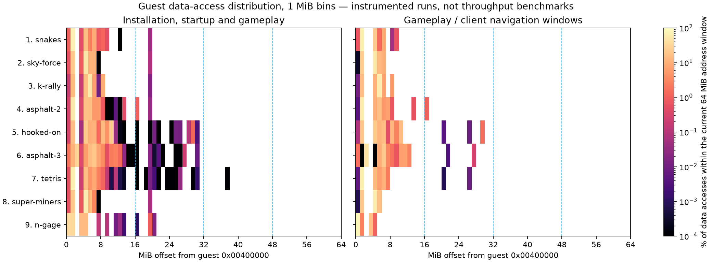

# Guest memory-access distribution and arena sizing

Captured 2026-10-14 on `wasm-port` at source parent `d94e6a4aa`, Chromium
153.0.8010.52, i7-10875H, hardware ANGLE/Vulkan, stock Nokia 5320. All eight
currently supported games and the N-Gage 1.40.1557 client were launched from
fresh browsers and temporary guest filesystems on a private HTTPS server.
Games reached actual gameplay; the client reached My Games and exercised
Home/library navigation and Options. Screenshots were visually reviewed.
Guest/page error collections were empty. All captures used normal installation,
including the N-Gage installers; the public prepared-image path was unchanged.

## Main findings

- A 32 MiB window from `0x00400000` covers all observed gameplay data-access
  start addresses within the existing 64 MiB window. Across installation and
  startup it covers virtually all such addresses too: Tetris has a handful of
  accesses above that bound. This is address coverage, not an actual hit rate.
- Whole chunk reservations are larger than the accessed spans. The largest
  currently arena-backed reservation extent needs a 46 MiB prefix during
  N-Gage installation; Tetris needs 38 MiB. A smaller window can force a whole
  heap chunk into separate backing and disable the shortcut for its process.
- **48 MiB is the conservative fixed-size candidate for these captures.** It
  contains every observed chunk currently placed in an arena and reduces
  arena capacity by 25%. It is not a measured performance optimum.
- **Per-process sizing has substantially more potential.** Many background
  processes need only 4–6 MiB of the current arena; the primary game/client
  needs about 15–38 MiB. The installer reaches 46 MiB and is destroyed before
  steady gameplay. Allocation-derived sizing is preferable to app-name rules.

## Distribution

Percentages below measure reads plus writes whose starting address fits a
candidate prefix, divided by those in the current 64 MiB address window.
Addresses outside that window are also counted and preserved in the JSON.
The chart uses a logarithmic color scale; white cells received zero accesses.



| # | App | Runtime data accesses | Within current window | Covered by 16 MiB | Covered by 32 MiB | Largest observed arena-backed extent |
| ---: | --- | ---: | ---: | ---: | ---: | ---: |
| 1 | snakes | 211,286,200 | 89.67% | 100.000% | 100.000% | 19 MiB |
| 2 | sky-force | 45,015,052 | 63.84% | 100.000% | 100.000% | 20 MiB |
| 3 | k-rally | 93,816,387 | 68.90% | 100.000% | 100.000% | 20 MiB |
| 4 | asphalt-2 | 229,041,215 | 81.87% | 98.942% | 100.000% | 19 MiB |
| 5 | hooked-on | 1,039,238,437 | 93.22% | 98.485% | 100.000% | 46 MiB |
| 6 | asphalt-3 | 238,293,656 | 95.24% | 99.720% | 100.000% | 46 MiB |
| 7 | tetris | 1,210,997,106 | 96.98% | 99.990% | 100.000% | 46 MiB |
| 8 | super-miners | 122,971,348 | 67.43% | 100.000% | 100.000% | 20 MiB |
| 9 | n-gage | 11,803,558 | 75.16% | 100.000% | 100.000% | 21 MiB |

The last column includes installation and startup, not only the runtime
window. Runtime routes span 2–30 guest seconds. They are sufficient to expose
frequently used ranges but do not cover every level, future allocation or
long-running session. Instrumentation changes host execution cost and can
affect polling frequency; it is not suitable for measuring throughput.

## Capacity estimates

These are logical arena capacities replayed from allocations and process
destruction. They are **not measured reductions in total browser PSS**. The
rounded per-process column uses the maximum future extent observed for each
process, rounded to one of 4, 8, 12, 16, 20, 24, 32, 40, 48 or 64 MiB. This
offline oracle is a potential saving, not an implemented online policy.

| # | App | Current peak / final | Fixed 48 MiB peak / final | Rounded per-process peak / final |
| ---: | --- | ---: | ---: | ---: |
| 1 | snakes | 320 / 320 MiB | 240 / 240 MiB | 52 / 52 MiB |
| 2 | sky-force | 320 / 320 MiB | 240 / 240 MiB | 56 / 56 MiB |
| 3 | k-rally | 320 / 320 MiB | 240 / 240 MiB | 56 / 56 MiB |
| 4 | asphalt-2 | 320 / 320 MiB | 240 / 240 MiB | 56 / 56 MiB |
| 5 | hooked-on | 896 / 832 MiB | 672 / 624 MiB | 184 / 160 MiB |
| 6 | asphalt-3 | 896 / 832 MiB | 672 / 624 MiB | 184 / 160 MiB |
| 7 | tetris | 896 / 832 MiB | 672 / 624 MiB | 196 / 180 MiB |
| 8 | super-miners | 320 / 320 MiB | 240 / 240 MiB | 56 / 56 MiB |
| 9 | n-gage | 768 / 768 MiB | 576 / 576 MiB | 128 / 128 MiB |

For Hooked On the per-process oracle changes final arena capacity from
832 to 160 MiB, a **672 MiB** potential reduction. Fixed 48 MiB changes it
from 832 to 624 MiB, a **208 MiB** reduction in arena capacity. Other allocations,
WASM high-water capacity and browser memory still exist.

## Should arenas grow?

A trace replay beginning at 4 MiB and doubling whenever a currently
arena-backed chunk would exceed the capacity predicts:

| # | App | Total growth steps | Growth during runtime windows | Final arena capacity | Hypothetical bytes copied |
| ---: | --- | ---: | ---: | ---: | ---: |
| 1 | snakes | 6 | 0 | 64 MiB | 44 MiB |
| 2 | sky-force | 7 | 0 | 80 MiB | 60 MiB |
| 3 | k-rally | 7 | 0 | 80 MiB | 60 MiB |
| 4 | asphalt-2 | 7 | 0 | 80 MiB | 60 MiB |
| 5 | hooked-on | 27 | 0 | 192 MiB | 236 MiB |
| 6 | asphalt-3 | 24 | 0 | 192 MiB | 208 MiB |
| 7 | tetris | 26 | 0 | 224 MiB | 244 MiB |
| 8 | super-miners | 7 | 0 | 80 MiB | 60 MiB |
| 9 | n-gage | 15 | 0 | 160 MiB | 112 MiB |

All modeled growth happens before the measured gameplay/navigation windows.
This supports trying adaptive allocation as a cold-path optimization. The copy
column assumes one copy of the previous capacity per doubling; allocator
peaks during movement and pointer-rebinding costs are not modeled. The replay
only resizes chunks the current 64 MiB implementation actually backs in an
arena; it does not attempt to absorb larger separately allocated chunks.

Growing a contiguous buffer can move it. Existing chunk bases, page mappings,
TLB entries, generated cached host spans and any retained C++ pointers must
remain valid. An ordinary `realloc` is insufficient. A practical sequence is:
choose an initial size using heap/stack reservations known before allocation;
grow only at a boundary with a complete pointer and alias update; use the
existing page-table fallback when stable growth cannot be established. Multiple
stable arena segments are another option, with additional generated access
cost that must be benchmarked. A proven runtime optimum requires uninstrumented
comparisons of startup, gameplay throughput and browser PSS.

## Conflicting large reservation

AknIconSrv reserves a separate 128 MiB chunk beginning at guest address
23 MiB, with only 4 KiB committed in the inspected gameplay snapshots. It
overlaps the fixed direct window. The existing `view::enter` mapping check
disables affine access when a mapped backing disagrees with the arena. Thus
address coverage alone cannot imply direct hits. A process-specific window
ending at guest 23 MiB could keep its earlier 19 MiB of arena-backed chunks
without overlapping that separate reservation. This needs runtime validation.

## Instrumentation and reproduction

`EKA2L1_MEMORY_ACCESS_PROFILE=ON` is a diagnostic CMake option, default OFF.
Generated ARM/Thumb scalar, proved-span and block-transfer loads/stores update
64-bit read/write counters in 1 MiB bins, tagged by guest process ASID.
The specialized EUser list scanner is instrumented too. Interpreter accessors
count data reads/writes. Instruction fetches and direct host C++ bulk copies
are excluded. Metadata records chunk creation, commit/decommit, destruction
and process-owned arenas. Counters are read only after the CPU route is parked.
Normal builds allocate no histogram and emit no counter updates or report API.

The retained capture WASM SHA-256 is
`b47b3378e51944fad36f9703be16f705d797ef510a7fe82624c6819aa0865933`.
ROM and package identities are recorded in each window report and match
`src/tests/wasm/games.json` and the current stock device.

```sh
cmake -S . -B build-wasm -DEKA2L1_MEMORY_ACCESS_PROFILE=ON
cmake --build build-wasm --target eka2l1_wasm test_aot_wasm -j4
node build-wasm/src/tests/aot/test_aot_wasm.js --memory-implementations-only
# Serve this diagnostic build on a private endpoint, then capture each catalogue ID:
node src/tests/wasm/memory-access-profile.mjs snakes NEW_OUTPUT PROFILE_SERVER_URL
python3 src/tests/benchmark/analyze_memory_access_profile.py CAPTURES SUMMARY.json
python3 src/tests/benchmark/render_memory_access_profile.py SUMMARY.json DISTRIBUTION.png
```

Native correctness passes 915 assertions in 37 cases. The instrumented WASM
suite passes 189 tests with zero failures, retaining its pre-existing labeled
crash-reproduction XFAIL. Added checks verify exact generated ARM/Thumb block
transfer read/write counts. The final harness was also checked through an
additional browser launch. A welcome-only and a differently labeled N-Gage
profile-tab attempt are preserved outside Git and excluded from this summary.
The first probe build needed the missing i64 memory opcode constants; its
failure log is preserved. An initial native-test invocation used the wrong
output path; the corrected full test run passed.

The normal build was rebuilt with profiling OFF and passes the same 189 WASM
tests. Its module has no memory-profile report export; the diagnostic module
has the expected export. The normal rebuilt SHA-256 is
`1c40e453036b095c10abd59a74e8b4568adb828db7d4a33afedb8eff851dc43f`.

Raw snapshots, screenshots, console logs and frozen diagnostic builds are at
`/home/claude/.scratch/eka-memory-window-20261014`. The public `.lan` service
continues to serve the previously verified uninstrumented runtime. No arena
policy or production allocation size was changed by this investigation.
